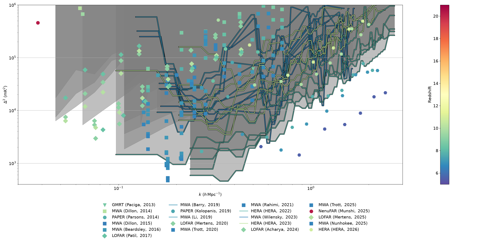

# ps21cm-limits

[](https://github.com/EoRImaging/ps21cm-limits/actions/workflows/test-suite.yml)
[](https://codecov.io/gh/EoRImaging/ps21cm-limits)
[](https://ps21cm-limits.readthedocs.io/en/latest/)
[](https://pypi.org/project/ps21cm-limits/)
[](https://pypi.org/project/ps21cm-limits/)
[](https://github.com/EoRImaging/ps21cm-limits/blob/main/LICENSE)

`ps21cm-limits` is a small utility that provides a compendium of published upper limits on the 21-cm power spectrum from the Epoch of Reionization (EoR) and Cosmic Dawn. It also provides functionality to plot these limits as a function of scale $k$ and redshift $z$. The observational limits are bundled alongside several theoretical predictions from simulations and experimental sensitivity estimates to allow for easy comparison.

The published limits are included in human-readable YAML files in the `data` folder, alongside the theoretical predictions in the `theory` folder and sensitivity estimates in the `sensitivities` folder. It is also possible to read in custom YAML files, and we welcome pull requests to add new observational data or theory models from published papers.

To use the code, check out the _Usage and examples_. For users who want to quickly explore the limits and make plots without needing to install anything, check out the new online interface: [ps21cmlimits.streamlit.app](https://ps21cmlimits.streamlit.app/)!



## Installation and dependencies

### User installation

* Clone the repository using ```git clone https://github.com/EoRImaging/ps21cm-limits```

* For a simple user installation, change directories into the `ps21cm-limits` folder and run ```pip install .``` (including the dot).

* To install without dependencies, run `pip install --no-deps .` (including the dot).

### Developer installation

* **pip installation**: Developers who would like to contribute to the code can install the package as: ```pip install -e .``` (including the dot). This will install the package in editable mode, which allows you to make changes to the code and have them immediately reflected when you import the package.

* **uv installation**: If you prefer to use `uv` to manage your environment, you can install the package in editable mode with the development dependencies using: ```uv sync```. To also install the dependencies for building the documentation, use ```uv sync --group docs```.

* **Using pre-commit**: To use pre-commit to prevent committing code that does not follow our style, you'll need to run `pre-commit install` in the top level `ps21cm-limits` directory.

* **Testing**: To run the tests, you can use the command `pytest` from the top level `ps21cm-limits` directory. If you have `uv` installed, you can also run the tests with the development dependencies using `uv run pytest`.

* **CLI debugging**: To debug the CLI, prefix the command you want to run with the environment variable `PS21CM_LIMITS_DEBUG=1`, e.g. ```PS21CM_LIMITS_DEBUG=1 ps21cm-limits plot-vs-k --out=MyPlot.pdf```. This will print out richly-formatted tracebacks instead of the high-level error messages.

## Usage and examples

There are three main ways to use `ps21cm-limits`: through the online graphical user interface (GUI), through the Python API in a notebook or script, or through the command line interface (CLI).

### Using the online GUI

The online GUI is the quickest way to explore published limits and generate plots without installing anything locally. It is built with [Streamlit](https://streamlit.io/) and lets you select datasets, apply filters, customize the display, and download both the data and resulting figures. You can access it at [ps21cmlimits.streamlit.app](https://ps21cmlimits.streamlit.app/). Note that the GUI may differ in its plotting style and customization options, as it sits on a different GitHub repository (although using this codebase as a dependency) and is maintained separately.

### Using the Python API

The Python API provides tools for loading, filtering, and plotting the included datasets. For a more complete walkthrough, see the _Tutorial notebook_. Here we just give a brief overview. All datasets are loaded with `load_limit_data`, `load_theory_model`, or `load_sensitivity_data`, which return a `DataSet` object. For available datasets, see `KNOWN_LIMITS`, `KNOWN_THEORIES`, and `KNOWN_SENSITIVITIES`. A simple example of loading the data and slicing it is shown below:

```python
from ps21cm_limits import load_limit_data, load_theory_model, load_sensitivity_data
from ps21cm_limits import KNOWN_LIMITS, KNOWN_THEORIES, KNOWN_SENSITIVITIES

hera2026 = load_limit_data("HERA2026")  # or ps21cm_limits.DataSet.load("HERA2026")
print(hera2026.data.as_pandas_df())
hera2026_trunc = hera2026.select_z_range(7, 10).select_k_range(0.1, 1)
hera2026_lowest = hera2026.select_lowest_delta_squared(per_z=True, per_tag=False)
```

The two main plotting functions are `plot_vs_k` and `plot_vs_z`, which show limits as a function of scale $k$ and redshift $z$, respectively. To make the default plot versus $k$, run:

```python
from ps21cm_limits import plot_vs_k, plot_vs_z

plot_vs_k()
```

The plotting functions accept keyword arguments to choose which observational limits, theory models, and sensitivity estimates to include. You can then customize their styles. For example, the following code plots the HERA limits between redshifts 7 and 11, bolds and shades the HERA 2023 result, adds the `Mesinger2016Faint` and `Mesinger2016Bright` theory models with custom colors and shaded regions, and adds the SKA-Low AA4 sensitivity estimate in red.

```python
from ps21cm_limits import plot_vs_k, plot_vs_z

plot_vs_k(
    limits=["HERA2022", "HERA2023", "HERA2026"],
    z_range=(7, 11),
    bold_limits=["HERA2023"],
    shade_limits=True,
    base_limit_style={"shade_alpha": 0.05},
    limit_styles={"HERA2023": {"shade_alpha": 0.5}},
    theories=["Mesinger2016Faint", "Mesinger2016Bright"],
    shade_theories=True,
    base_theory_style={"color": "black"},
    theory_styles={
        "Mesinger2016Faint": {"linestyle": "--"},
        "Mesinger2016Bright": {"linestyle": ":"},
    },
    sensitivities={"SKA-AA4": "Breitman2026_AA4_deep1080h"},
    sensitivity_style={"SKA-AA4": {"color": "red"}},
    publication=True,
    out="MyPlot.pdf",
)
```

Note that custom sensitivity files must use the same format as the limits, i.e. units of $\Delta^2(k)$ in mK$^2$ and $k$ in $h\,$Mpc$^{-1}$. 21cmSense v3 writes $k$ in Mpc$^{-1}$ (see the `k_unit` attribute of its output file), so these values must be divided by $h$. To ensure that the correct units are used, the `k_unit: h/Mpc` attribute must be present in the YAML file. Files without it are rejected.

### Using the CLI

After installation, you can use the `ps21cm-limits` command to make plots from the terminal. Run `ps21cm-limits -h`, `ps21cm-limits plot-vs-k -h`, or `ps21cm-limits plot-vs-z -h` to see the available options.

For the default plot of all limits as a function of scale $k$, run:

```bash
ps21cm-limits plot-vs-k --out=MyPlot.pdf
```

The CLI exposes the same plotting options as the Python API. Dictionary-style options, such as sensitivities and custom styles, are passed as JSON strings:

```bash
ps21cm-limits plot-vs-k \
    --limits HERA2022 HERA2023 HERA2026 \
    --z-range 7 11 \
    --bold-limits HERA2023 \
    --shade-limits \
    --base-limit-style '{"shade_alpha": 0.05}' \
    --limit-styles '{"HERA2023": {"shade_alpha": 0.5}}' \
    --theories Mesinger2016Faint Mesinger2016Bright \
    --shade-theories \
    --base-theory-style '{"color": "black"}' \
    --theory-styles '{"Mesinger2016Faint": {"linestyle": "--"}, "Mesinger2016Bright": {"linestyle": ":"}}' \
    --sensitivities '{"SKA-AA4": "Breitman2026_AA4_deep1080h"}' \
    --sensitivity-style '{"SKA-AA4": {"color": "red"}}' \
    --publication \
    --out MyPlot.pdf
```

## Community guidelines

### Contributing to the repository

We welcome contributions to this repository from the community. If you would like to contribute, please follow these guidelines:

* If you would like to add new observational limits, theory models or sensitivities, ensure that they come from peer-reviewed published papers and make a pull request to add them to the repository (see _Developer installation_ for information on how to set up your environment). The data should be added in the form of a YAML file in the data folder (for observational limits), the theory folder (for theory models), or the sensitivities folder (for sensitivity estimates) following the format of the existing files.

    ```yaml
    telescope: GMRT
    author: Paciga
    year: 2013
    doi: 10.1093/mnras/stt753
    data:
        delta_squared: [[6.15e4]]
        k: [[0.5]]
        z: [8.6]
    ```

* If you would like to plot or compare unpublished data, you can create a local YAML file in the same format and pass its path wherever a dataset name is accepted, e.g. `plot_vs_k(limits=["HERA2026", "/path/to/my_data.yaml"])` or `load_limit_data("/path/to/my_data.yaml")`. The same works for theories (`theories=` and `load_theory_model`) and sensitivities (`sensitivities=` and `load_sensitivity_data`).

* If you would like to report a bug or request a feature, please file an issue on the GitHub repository.

### License

This code is fully open-source, available under BSD 2-Clause License. See the LICENSE file for more details.  Please feel free to use and modify the code as needed.
